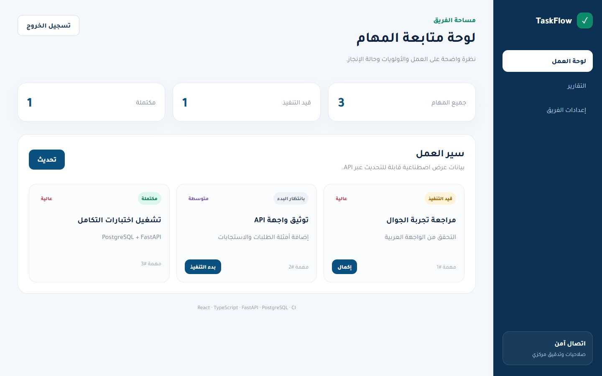
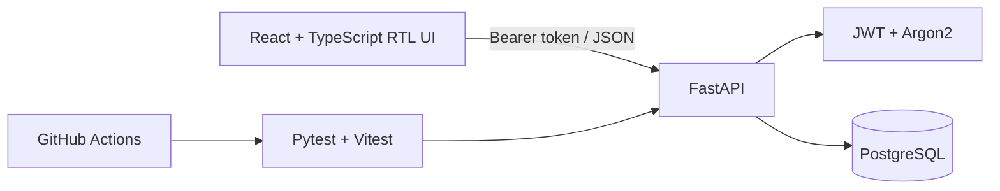

<div align="center">

# Secure TaskFlow

**A compact, production-minded Arabic RTL full-stack engineering sample.**

[](https://github.com/mohhdkh/secure-taskflow/actions/workflows/ci.yml)


</div>

## Why this repository exists

My larger portfolio systems are private to protect product IP. This public repository provides a focused, reviewable example of my engineering approach without exposing proprietary healthcare or customer code.

It demonstrates typed frontend work, authenticated APIs, server-enforced authorization, relational persistence, automated tests, Docker and a PostgreSQL-backed CI quality gate.

## Screenshot



## Architecture



## Key engineering points

- Passwords are hashed with Argon2; plaintext credentials are never stored.
- JWTs expire and every protected request resolves the current database user.
- Task ownership is enforced by the API, not hidden only in the UI.
- Pydantic models constrain status, priority and input lengths.
- CI executes backend integration tests against PostgreSQL 16.
- The frontend test verifies the Arabic login-to-dashboard path.
- Docker Compose provides a reproducible three-service environment.

## Authorization verification matrix

| Security boundary | Automated evidence |
|---|---|
| Anonymous request | Protected task endpoints return `401` |
| Invalid bearer token | Malformed JWT is rejected with `401` |
| Expired or malformed token subject | Expired JWTs and missing/non-numeric subjects are rejected with `401` |
| Wrong authentication scheme | Non-Bearer credentials are rejected without reaching task data |
| Removed account | A valid token is rejected after its database user is deleted |
| Member read scope | A member list contains only that member's tasks |
| Cross-user mutation | Update and delete return `404` for another member's task |
| Administrator scope | An administrator can manage a member-owned task |
| Invalid input | Unknown fields, server-owned fields and invalid enum/length values return `422` |
| Corrupted stored credential | A malformed password hash fails closed as invalid credentials |
| Missing resource | Update and delete return a consistent `404` |

The suite contains **28 backend/API cases** plus **1 frontend component test**. Pull requests run the backend suite against PostgreSQL 16 before merge. See the [measured engineering evidence](docs/engineering-evidence.md).

## Run with Docker

```bash
git clone https://github.com/mohhdkh/secure-taskflow.git
cd secure-taskflow
docker compose up --build
```

- Web: `http://localhost:5173`
- API: `http://localhost:8000`
- API docs: `http://localhost:8000/docs`

Synthetic demo account:

```text
username: demo_admin
password: Demo123!
```

Never reuse these development credentials in a real deployment.

## Run tests locally

```bash
cd backend
python -m venv .venv
# Windows: .venv\Scripts\activate
# Linux/macOS: source .venv/bin/activate
pip install -r requirements.txt
pytest -q

cd ../frontend
npm ci
npm test
npm run build
```

The GitHub Actions workflow publishes the backend JUnit report as a downloadable artifact on every run.

## Repository map

```text
backend/app/        FastAPI application, persistence and security
backend/tests/      API integration tests
frontend/src/       React RTL interface and component test
.github/workflows/  PostgreSQL-backed CI quality gate
docs/               Screenshot and technical case study
```

## Case study

Read the full [problem, decisions, alternatives and result](docs/case-study.md).

## Safety

This repository is an original generic engineering sample. It contains no patient information, client data, production credentials or proprietary source code from private portfolio projects.

## Author

**Mohammed Khaled** — Full-Stack & Flutter Developer  
[GitHub](https://github.com/mohhdkh) · [LinkedIn](https://www.linkedin.com/in/mohammed-khattab1/)
